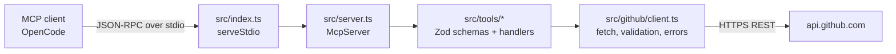

# RepoLens

RepoLens is a lightweight, read-only [Model Context Protocol](https://modelcontextprotocol.io/) server that gives MCP clients such as OpenCode structured access to GitHub repository information. It runs locally over stdio, uses the official GitHub REST API, and has no runtime dependencies beyond the MCP SDK and Zod.

## Features

- Repository metadata: description, owner, language, stars, forks, default branch, dates, license, visibility, and open-issue count.
- Recent commits with optional branch selection.
- Issue listing with pull requests excluded.
- Pull request listing with source and target branches.
- Language byte counts and percentage distribution.
- README retrieval with correct base64 decoding and a 64 KiB output limit.
- `ping` health tool.
- Optional `GITHUB_TOKEN` authentication, strict input validation, request timeouts, and typed error handling.
- stdout reserved exclusively for MCP JSON-RPC; diagnostics go to stderr.

## Architecture



- `src/index.ts` — process entry point and stdio transport.
- `src/server.ts` — constructs the `McpServer` and registers all tools.
- `src/github/client.ts` — GitHub HTTP requests, validation, timeouts, and error mapping.
- `src/github/types.ts` — strict types for the GitHub fields RepoLens consumes.
- `src/tools/` — one module per tool family plus shared result helpers.
- `tests/` — mocked unit tests and end-to-end MCP tests.

## Prerequisites

- Node.js 20 or newer
- npm
- Network access to `https://api.github.com` for real tool calls

The project uses the v2 MCP TypeScript SDK (`@modelcontextprotocol/server`) and Zod 4. Installed SDK APIs were verified against the package exports and declaration files.

## Installation

```bash
git clone <repository-url>
cd RepoLens
npm install
npm run build
```

## Commands

| Command | Purpose |
| --- | --- |
| `npm run build` | Type-check and compile `src/` into `dist/` |
| `npm run typecheck` | Type-check without emitting files |
| `npm test` | Build, then run all automated tests |
| `npm run dev` | Run the TypeScript source with auto-reload |
| `npm start` | Run the compiled server from `dist/` |

## OpenCode integration

RepoLens ships a project-local V2 OpenCode configuration in `opencode.json`:

```json
{
  "$schema": "https://opencode.ai/config.json",
  "mcp": {
    "servers": {
      "repolens": {
        "type": "local",
        "command": ["node", "dist/index.js"],
        "cwd": ".",
        "environment": {
          "GITHUB_TOKEN": "{env:GITHUB_TOKEN}"
        }
      }
    }
  }
}
```

This launches the compiled JavaScript directly, resolves paths from the workspace, and avoids machine-specific absolute paths. OpenCode V2 places servers under `mcp.servers`; the default `legacy` protocol matches the protocol revision negotiated by the installed SDK. Verify the connection with:

```bash
npm run build
opencode mcp list
```

Expected output includes `✓ repolens  connected`. Configuration changes reload automatically; use `/reload` in OpenCode to force a refresh. Existing global OpenCode settings are not modified by this project file.

## Optional GitHub token

Unauthenticated access works for public repositories but is rate limited to 60 requests per hour per IP. To authenticate:

```bash
cp .env.example .env
# Edit .env and set GITHUB_TOKEN=your_token_here
export GITHUB_TOKEN="$(grep '^GITHUB_TOKEN=' .env | cut -d= -f2-)"
```

The OpenCode configuration forwards `GITHUB_TOKEN` from the client environment. A fine-grained token with public repository read access is sufficient. The token is sent only to `api.github.com` in the `Authorization` header; it is never logged, returned by a tool, or written to configuration. `.env` is gitignored.

## Available tools

| Tool | Arguments | Description |
| --- | --- | --- |
| `ping` | none | Returns `pong`; verifies the MCP connection. |
| `get_repo_info` | `owner`, `repo` | Repository metadata and URL. |
| `get_commits` | `owner`, `repo`, `branch?`, `limit?` | Recent commits; `limit` defaults to 10, maximum 50. |
| `list_issues` | `owner`, `repo`, `state`, `limit?` | Issues only; pull requests are filtered out. `state` is `open`, `closed`, or `all`. |
| `list_pull_requests` | `owner`, `repo`, `state`, `limit?` | Pull requests with branches and URL. |
| `get_repo_languages` | `owner`, `repo` | Language bytes and percentage distribution. |
| `get_repo_readme` | `owner`, `repo` | Decoded README, path, and repository URL. |

Owner and repository names are restricted to letters, digits, `.`, `_`, and `-`. Limits are integers from 1 to 50.

GitHub's repository `open_issues_count` includes pull requests; RepoLens labels this explicitly in the `get_repo_info` output. Tool results are compact plain text intended for model consumption. README content is wrapped in delimiters and labelled as untrusted data.

## Example usage

In OpenCode Code Mode, tools are grouped under the server name:

```text
tools.repolens.get_repo_info({ owner: "octocat", repo: "Hello-World" })
tools.repolens.list_issues({ owner: "octocat", repo: "Hello-World", state: "open", limit: 5 })
```

Raw MCP clients can call a tool directly:

```json
{
  "jsonrpc": "2.0",
  "id": 1,
  "method": "tools/call",
  "params": {
    "name": "get_commits",
    "arguments": { "owner": "octocat", "repo": "Hello-World", "limit": 2 }
  }
}
```

```json
{
  "jsonrpc": "2.0",
  "id": 1,
  "result": {
    "content": [
      { "type": "text", "text": "1. 7fd1a60b01f9\n   Message: Merge pull request #6 ...\n   ..." }
    ]
  }
}
```

## Security considerations

- Only read-only GitHub REST endpoints are used; no write operations exist.
- Requests are restricted to the official `https://api.github.com` origin.
- URL path segments are encoded and all user inputs are validated before use.
- `GITHUB_TOKEN` is read from the environment, redacted from error text, and never printed.
- Repository content is treated as data, not instructions; the README result is delimited accordingly.
- Failed requests return MCP tool errors rather than terminating the server.
- Secrets, build artifacts, dependencies, logs, and temporary files are gitignored.

## Testing

```bash
npm test
```

The suite covers successful requests, invalid arguments, HTTP errors, rate limits, network failures, timeouts, issue filtering, language percentage calculations, README decoding, tool discovery, tool invocation, and stdout purity. External HTTP is mocked; no token is needed. A live smoke test against `octocat/Hello-World` was also performed successfully during development.

## Troubleshooting

| Symptom | Check |
| --- | --- |
| OpenCode does not list RepoLens | Run `npm run build`, then `opencode mcp list`; use `/reload` after config edits. |
| Server starts but tools are missing | Verify `dist/index.js` exists and that `tools/list` returns seven tools. |
| `GitHub authentication failed` | Set a valid `GITHUB_TOKEN` in the environment. |
| `Repository or resource not found` | Check the owner/repo spelling, or provide a token for accessible private repositories. |
| Rate limit or `Retry after` message | Wait for the reset time or authenticate to raise the limit. |
| Request timed out | Check outbound HTTPS access to `api.github.com`; the client timeout is 10 seconds. |
| README content ends abruptly | The output is intentionally truncated at 64 KiB. |
| Empty language list | GitHub reports no detected languages for that repository. |

## Limitations

- No pagination beyond a single GitHub page; issue requests fetch up to 100 items before filtering pull requests.
- No commit diffs, file trees, release data, or arbitrary file reads.
- README retrieval uses the repository default README only, without a branch or path option.
- No caching; every tool call performs a fresh HTTP request.
- Unauthenticated requests are subject to GitHub's IP-based rate limit.
- Read-only by design: no issues, commits, pull requests, or files can be modified.

No commits or pushes are made automatically.
