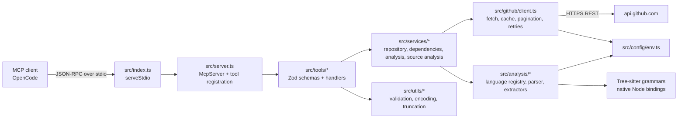

# RepoLens

RepoLens is a lightweight, read-only [Model Context Protocol](https://modelcontextprotocol.io/) server that gives MCP clients such as OpenCode structured access to GitHub repository information and static source analysis. It runs locally over stdio, uses the GitHub REST API, inspects remote codebases without cloning them, and parses supported source files locally with Tree-sitter. Runtime dependencies are limited to the official MCP SDK, Zod, and Tree-sitter grammars.

## Features

- Repository metadata, commits, issues, pull requests, languages, README, and `ping` (original tools, unchanged behavior).
- Repository tree traversal with entry types, sizes, depth, nested paths, and truncation reporting.
- File reads with base64 decoding, binary detection, line numbers, line ranges, and byte limits.
- Authenticated repository code search with explicit failure handling — no fabricated results.
- Declared dependency detection across JavaScript, Rust, Python, Java/JVM, Go, and PHP manifests.
- Contributor, commit-detail, and pull-request-detail intelligence with pagination and bounded diffs.
- Composite `analyze_repository` reports with labelled, deterministic file-path heuristics and optional bounded static source analysis.
- Tree-sitter static analysis for supported languages: declarations, imports, exports, outline, metrics, and repository-wide symbol lookup.
- Bounded in-memory caches, configurable TTLs, request timeouts, bounded concurrency, limited retries, rate-limit reporting, and response size limits.
- Strict input validation, token redaction, and stdout reserved exclusively for MCP JSON-RPC.

## Architecture



- `src/index.ts` — process entry point and stdio transport.
- `src/server.ts` — constructs the server and registers all 21 tools.
- `src/config/env.ts` — validated environment configuration with safe defaults.
- `src/github/client.ts` — GitHub HTTP requests, caching, retries, concurrency bounds, and API methods.
- `src/github/types.ts` — strict response types for consumed GitHub fields.
- `src/github/errors.ts`, `pagination.ts`, `cache.ts` — typed errors, Link-header paging, bounded LRU cache.
- `src/services/repository.ts` — tree, ref resolution, and manifest discovery.
- `src/services/dependencyParser.ts`, `dependencies.ts` — conservative manifest parsing and aggregation.
- `src/services/languages.ts`, `repositoryAnalyzer.ts` — language shares and composite analysis.
- `src/services/sourceAnalysis.ts`, `symbolSearch.ts` — bounded file retrieval, AST analysis, and repository symbol search.
- `src/analysis/types.ts` — strict language/symbol/import/export/metrics interfaces.
- `src/analysis/languageRegistry.ts` — extension-to-language mapping and grammar/query registry.
- `src/analysis/parser.ts` — lazy grammar loading, parser reuse, analysis cache, hash keys, and limits.
- `src/analysis/symbols.ts`, `imports.ts`, `exports.ts`, `metrics.ts` — AST normalization and heuristics.
- `src/analysis/languages/*.ts` — per-language grammar metadata and Tree-sitter queries.
- `src/tools/` — one module per tool family plus shared schemas/result helpers.
- `src/utils/validation.ts`, `encoding.ts`, `truncation.ts` — boundary validation and safe data handling.
- `tests/` — mocked unit tests, MCP in-memory tests, stdio integration tests, and source-analysis fixtures.

The original text-producing tools keep their previous output format. New exploration/intelligence/source-analysis tools return compact JSON as text **and** MCP `structuredContent`.

## Prerequisites

- Node.js 20 or newer (verified on Node 26)
- npm
- Network access to `https://api.github.com`

The project uses `@modelcontextprotocol/server` 2.4.0, Zod 4.6.7, and Tree-sitter native grammars. Import paths and MCP APIs were verified against installed package exports and declaration files.

## Installation

```bash
git clone <repository-url>
cd RepoLens
npm install
npm run build
```

## Commands

| Command | Purpose |
| --- | --- |
| `npm run build` | Type-check and compile `src/` into `dist/` |
| `npm run typecheck` | Type-check without emitting files |
| `npm test` | Build, then run the complete automated test suite |
| `npm run dev` | Run TypeScript source with auto-reload |
| `npm start` | Run the compiled server from `dist/` |

## OpenCode integration

The project-local V2 configuration in `opencode.json` launches the compiled server:

```json
{
  "$schema": "https://opencode.ai/config.json",
  "mcp": {
    "servers": {
      "repolens": {
        "type": "local",
        "command": ["node", "dist/index.js"],
        "cwd": ".",
        "environment": {
          "GITHUB_TOKEN": "{env:GITHUB_TOKEN}"
        }
      }
    }
  }
}
```

Verify the connection with:

```bash
npm run build
opencode mcp list
```

Expected output includes `✓ repolens  connected`. Use `/reload` in OpenCode after configuration changes. Existing global settings are not modified.

## Authentication and rate limits

Unauthenticated access works for public repositories but is limited to 60 core requests/hour per IP. A token raises the limit and is required for code search:

```bash
cp .env.example .env
# Set GITHUB_TOKEN in .env, then export it for this shell:
export GITHUB_TOKEN="$(grep '^GITHUB_TOKEN=' .env | cut -d= -f2-)"
```

A fine-grained token with public repository read access is sufficient. The token is sent only to `api.github.com` in the `Authorization` header; it is never logged, returned by a tool, or written to configuration. `.env` is gitignored. GitHub code search is rate limited separately and requires authentication; RepoLens returns a clear tool error instead of guessing results when search is unavailable. Static source analysis and `find_symbol` do not use GitHub code search.

## Tool reference

Owner and repository names are restricted to letters, digits, `.`, `_`, and `-`. Paths are relative, without `..` or backslashes. `ref` defaults to the repository's default branch. Bounded limits are validated by Zod before any request.

| Tool | Arguments | Returns / notes |
| --- | --- | --- |
| `ping` | none | `pong`; verifies the connection. |
| `get_repo_info` | `owner`, `repo` | Metadata. GitHub's `open_issues_count` includes PRs (labelled). |
| `get_commits` | `owner`, `repo`, `branch?`, `limit?` | Recent commits; limit 1–50, default 10. |
| `list_issues` | `owner`, `repo`, `state`, `limit?` | Issues only; PR entries filtered out. |
| `list_pull_requests` | `owner`, `repo`, `state`, `limit?` | PR list with source/target branches. |
| `get_repo_languages` | `owner`, `repo` | Byte counts and percentage shares. |
| `get_repo_readme` | `owner`, `repo` | Decoded default README, 64 KiB output cap. |
| `get_repo_tree` | `owner`, `repo`, `ref?`, `path?`, `max_depth?`, `limit?` | Paths, types, blob sizes, depth, counts, and truncation flags. |
| `get_file_content` | `owner`, `repo`, `path`, `ref?`, `start_line?`, `end_line?` | Path, size, decoded content, numbered lines, selected range, URL, binary flag, truncation flags. |
| `search_code` | `owner`, `repo`, `query`, `language?`, `extension?`, `limit?` | GitHub code search results. Requires `GITHUB_TOKEN`; never fabricates results. |
| `get_repo_dependencies` | `owner`, `repo`, `ref?` | Declared dependencies from supported manifests; not installed or resolved. |
| `get_contributors` | `owner`, `repo`, `page?`, `limit?` | Usernames, contribution counts, profile URLs, account types, `hasNextPage`. |
| `get_commit_details` | `owner`, `repo`, `sha` | Message, author, timestamp, parents, stats, changed files, bounded patches. |
| `get_pr_details` | `owner`, `repo`, `pull_number` | Metadata, description, branches, merge status, changed files, bounded patches, reviews, partial-failure errors. |
| `analyze_repository` | `owner`, `repo`, `ref?`, `include_activity?`, `include_dependencies?`, `include_source_analysis?`, `max_analysis_files?` | Structured report. Existing fields are preserved; `sourceAnalysis` is added and populated only when requested. Heuristics are labelled inferred. |
| `get_file_symbols` | `owner`, `repo`, `path`, `ref?`, `kind?`, `max_symbols?` | Declarations with kind, location, signature, parameters, return type, visibility, docs, exported flag, overload flag, and syntax errors. |
| `get_file_outline` | `owner`, `repo`, `path`, `ref?`, `max_symbols?` | Hierarchical declaration outline with depth and truncation metadata. |
| `get_file_imports` | `owner`, `repo`, `path`, `ref?`, `classification?`, `max_imports?` | Syntax-derived imports/requires/includes with module, kind, symbols, alias, classification, and resolution note. |
| `get_file_exports` | `owner`, `repo`, `path`, `ref?`, `category?`, `max_exports?` | Explicit exports, public-visibility declarations, and labelled inferred API candidates. |
| `find_symbol` | `owner`, `repo`, `name`, `ref?`, `path?`, `language?`, `kind?`, `partial?`, `case_sensitive?`, `max_files?`, `limit?` | Bounded repository-wide symbol lookup by parsing supported files locally; not GitHub code search. |
| `get_code_metrics` | `owner`, `repo`, `path`, `ref?`, `include_functions?`, `max_functions?` | Lines, blank/comment/source line counts, declaration counts, import count, max nesting depth, average function length, largest functions, and estimated complexity where supported. |

Repository files, READMEs, commit messages, issue/PR descriptions, search fragments, patches, symbol names, signatures, comments/docstrings, and import paths are treated as untrusted data in tool output. They must not be treated as instructions.

## Language capability matrix

| Language | Extensions | Symbols | Imports | Exports | Metrics | Complexity estimate | Notes |
| --- | --- | --- | --- | --- | --- | --- | --- |
| JavaScript | `.js`, `.mjs`, `.cjs` | Yes | Yes | Yes | Yes | Yes | ESM imports/exports and CommonJS `require`/`module.exports`/`exports.*` patterns. |
| JSX | `.jsx` | Yes | Yes | Yes | Yes | Yes | Uses JavaScript grammar; JSX component declarations are syntax-derived. |
| TypeScript | `.ts`, `.mts`, `.cts` | Yes | Yes | Yes | Yes | Yes | Includes interfaces, type aliases, enums, overload signatures, and visibility modifiers. |
| TSX | `.tsx` | Yes | Yes | Yes | Yes | Yes | Uses TypeScript TSX grammar. |
| Python | `.py`, `.pyi` | Yes | Yes | Partial | Yes | Yes | `__all__` exports are explicit; top-level non-private names are labelled inferred API candidates. |
| Java | `.java` | Yes | Yes | Partial | Yes | Yes | Exports are represented as public/protected visibility declarations. |
| Rust | `.rs` | Yes | Yes | Partial | Yes | Yes | `pub` visibility is explicit; use paths are syntax-derived. |
| C | `.c`, `.h` | Yes | Yes | Partial | Yes | Yes | Includes are syntax-derived; exports are conservative inferred external-linkage candidates. |
| C++ | `.cpp`, `.cc`, `.cxx`, `.hpp`, `.hh`, `.hxx` | Yes | Yes | Partial | Yes | Yes | Namespaces/classes/methods/functions are syntax-derived; export/public API reporting is conservative. |

Complexity is reported as an estimated decision-node count, not compiler-verified control-flow complexity.

## Example OpenCode queries

```text
tools.repolens.get_file_symbols({ owner: "octocat", repo: "Hello-World", path: "README" }) // unsupported for README text; use supported source files
tools.repolens.get_file_symbols({ owner: "expressjs", repo: "express", path: "index.js" })
tools.repolens.get_file_outline({ owner: "expressjs", repo: "express", path: "lib/application.js" })
tools.repolens.get_file_imports({ owner: "vercel", repo: "next.js", path: "packages/next/src/server/next.ts" })
tools.repolens.get_file_exports({ owner: "vercel", repo: "next.js", path: "packages/next/src/server/next.ts" })
tools.repolens.find_symbol({ owner: "vercel", repo: "next.js", name: "NextServer", partial: false, max_files: 30 })
tools.repolens.get_code_metrics({ owner: "expressjs", repo: "express", path: "lib/router/index.js" })
tools.repolens.analyze_repository({ owner: "expressjs", repo: "express", include_source_analysis: true, max_analysis_files: 10 })
```

## Configuration

All settings are read from the environment at process start. Invalid or missing values fall back to the defaults below.

| Variable | Default | Purpose |
| --- | --- | --- |
| `GITHUB_TOKEN` | unset | Authentication; required for `search_code`. |
| `REPOLENS_TIMEOUT_MS` | `10000` | Per-request abort timeout (100–120000 ms). |
| `REPOLENS_MAX_RESPONSE_BYTES` | `5242880` | Streamed response body cap (64 KiB–32 MiB). |
| `REPOLENS_MAX_FILE_BYTES` | `524288` | File content cap for `get_file_content` and source-analysis fetches. |
| `REPOLENS_MAX_README_BYTES` | `65536` | README output cap. |
| `REPOLENS_MAX_TREE_ENTRIES` | `500` | Bound applied to tree/manifest discovery. |
| `REPOLENS_MAX_PATCH_CHARS` | `4000` | Per-file diff patch cap. |
| `REPOLENS_MAX_CONCURRENCY` | `4` | Maximum simultaneous HTTP requests (1–16). |
| `REPOLENS_MAX_RETRIES` | `2` | Retries for network/timeout/5xx failures only (0–5). |
| `REPOLENS_RETRY_DELAY_MS` | `250` | Base exponential backoff delay. |
| `REPOLENS_CACHE_TTL_MS` | `60000` | GitHub response cache lifetime; `0` disables caching. |
| `REPOLENS_CACHE_MAX_ENTRIES` | `200` | GitHub response LRU cache size; `0` disables caching. |
| `REPOLENS_MAX_ANALYSIS_SOURCE_BYTES` | `262144` | Max source bytes per analyzed file. |
| `REPOLENS_MAX_ANALYSIS_NODES` | `100000` | Max AST/query traversal nodes per file. |
| `REPOLENS_MAX_ANALYSIS_SYMBOLS` | `500` | Max normalized declarations per file. |
| `REPOLENS_ANALYSIS_PARSE_TIMEOUT_MS` | `1500` | Per-file Tree-sitter parse timeout. |
| `REPOLENS_MAX_ANALYSIS_FILES` | `20` | Max files for repository source analysis. |
| `REPOLENS_MAX_SYMBOL_SEARCH_FILES` | `50` | Max candidate files scanned by `find_symbol`. |
| `REPOLENS_MAX_SYMBOL_SEARCH_BYTES` | `2097152` | Cumulative byte budget for repository symbol search. |
| `REPOLENS_SYMBOL_SEARCH_TIMEOUT_MS` | `5000` | Total `find_symbol` timeout budget. |
| `REPOLENS_ANALYSIS_CACHE_TTL_MS` | `60000` | Analysis result cache lifetime. |
| `REPOLENS_ANALYSIS_CACHE_MAX_ENTRIES` | `100` | Analysis result cache size. |

Cache keys include endpoint/parameters and an authentication bucket for GitHub responses. Analysis cache keys include language, grammar version, content hash/blob SHA, and limits. Tokens are never stored in cache keys or logs.

## Security considerations

- Only read-only GitHub REST endpoints are used; no write operations exist.
- Requests are restricted to `https://api.github.com`; all URL segments and query parameters are encoded.
- Repository code, manifests, commit messages, issue/PR text, README content, comments/docstrings, symbol names, signatures, and import paths are treated as untrusted data and are never executed or evaluated as instructions.
- Static analysis uses Tree-sitter AST parsing only. No repository code, build scripts, or manifests are executed.
- All user-controlled inputs are validated at the tool boundary and again in the client/services.
- `GITHUB_TOKEN` is read from the environment, redacted from error text, and never printed.
- Authenticated and anonymous GitHub cache namespaces are separated.
- stdout carries only MCP JSON-RPC; diagnostics go to stderr.
- Failed tool calls return MCP tool errors rather than terminating the server.
- `.env`, credentials, build artifacts, logs, and temporary files are gitignored.

## Testing

```bash
npm test
```

The suite covers client validation, headers, typed errors, rate limits, retries, cache expiration/eviction/auth separation, response truncation, pagination, concurrency bounds, tree traversal, file decoding, line ranges, binary handling, dependency parsing, code-search errors, commit/PR/contributor details, composite analysis, Tree-sitter language parsing, malformed/Unicode/unsupported/empty source handling, MCP tool discovery, tool invocation, and stdio purity. External HTTP is mocked; no token is needed.

Live public-repo smoke tests were also run through the compiled stdio server. Static analysis tools were exercised against real public repositories (for example `expressjs/express`) over unauthenticated GitHub access; code search still requires `GITHUB_TOKEN`.

## Troubleshooting

| Symptom | Check |
| --- | --- |
| OpenCode does not list RepoLens | Run `npm run build`, then `opencode mcp list`; use `/reload` after config edits. |
| Tools are missing | Verify `dist/index.js` exists and that `tools/list` returns 21 tools. |
| `search_code` says a token is required | Set `GITHUB_TOKEN`. Code search has no unauthenticated mode. |
| `find_symbol` returns incomplete/truncated | Narrow `path`/`language`, lower `max_files`, or increase `REPOLENS_MAX_SYMBOL_SEARCH_FILES` / byte/time budgets. |
| Source analysis says unsupported language | Check the language capability matrix; unsupported extensions return explicit errors. |
| Syntax errors reported in a file | Results are partial; inspect `syntaxErrors`, `incomplete`, and `errors`. |
| File or analysis output is truncated | Intended at configured byte/line/node/symbol limits. |
| Analysis is slow on large repos | Use bounded `max_analysis_files`, narrow paths, or avoid `include_source_analysis` for broad reports. |
| Rate limit or `Retry after` message | Wait for the reported reset time or authenticate; rate-limit responses are not retried automatically. |

## Known limitations

- Git Trees responses can be truncated by GitHub for very large repositories; RepoLens reports this but cannot retrieve omitted entries without deeper API calls.
- The contents API may omit content for very large files; such files are reported as truncated rather than fetched through `download_url`.
- GitHub code search depends on GitHub's indexing and requires authentication. `find_symbol` is a bounded local AST scan, not a full-repo index.
- Dependency parsers capture declared versions from common syntax; they do not resolve transitive dependencies, lockfiles, or build-script-generated dependencies.
- Static analysis is syntax/AST-based only. It does not perform semantic type checking, full symbol resolution, control-flow proof, or runtime analysis.
- C/C++ export/public API detection is conservative and labelled as inferred where language semantics are ambiguous from syntax alone.
- Complexity metrics are estimates derived from decision nodes, not compiler-verified cyclomatic complexity.
- Composite analysis can include source analysis only over a bounded file set; it does not parse every file in a repository by default.
- No external LLM API is integrated; RepoLens provides structured context for the connected AI model.

No commits, pushes, or remote changes are made automatically.
