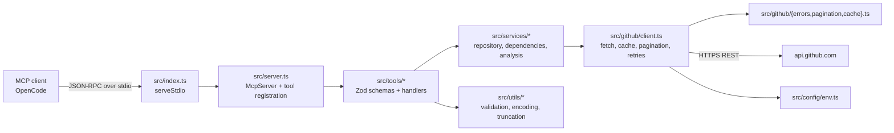

# RepoLens

RepoLens is a lightweight, read-only [Model Context Protocol](https://modelcontextprotocol.io/) server that gives MCP clients such as OpenCode structured access to GitHub repository information. It runs locally over stdio, uses the GitHub REST API, and inspects remote codebases without cloning them. Runtime dependencies are limited to the official MCP SDK and Zod.

## Features

- Repository metadata, commits, issues, pull requests, languages, README, and `ping` (original tools, unchanged behavior).
- Repository tree traversal with entry types, sizes, depth, nested paths, and truncation reporting.
- File reads with base64 decoding, binary detection, line numbers, line ranges, and byte limits.
- Authenticated repository code search with explicit failure handling — no fabricated results.
- Declared dependency detection across JavaScript, Rust, Python, Java/JVM, Go, and PHP manifests.
- Contributor, commit-detail, and pull-request-detail intelligence with pagination and bounded diffs.
- Composite `analyze_repository` reports with labelled, deterministic file-path heuristics.
- Bounded in-memory cache, configurable TTL, request timeouts, bounded concurrency, limited retries, rate-limit reporting, and response size limits.
- Strict input validation, token redaction, and stdout reserved exclusively for MCP JSON-RPC.

## Architecture



- `src/index.ts` — process entry point and stdio transport.
- `src/server.ts` — constructs the server and registers all 15 tools.
- `src/config/env.ts` — validated environment configuration with safe defaults.
- `src/github/client.ts` — GitHub HTTP requests, caching, retries, concurrency bounds, and API methods.
- `src/github/types.ts` — strict response types for consumed GitHub fields.
- `src/github/errors.ts`, `pagination.ts`, `cache.ts` — typed errors, Link-header paging, bounded LRU cache.
- `src/services/repository.ts` — tree, ref resolution, and manifest discovery.
- `src/services/dependencyParser.ts`, `dependencies.ts` — conservative manifest parsing and aggregation.
- `src/services/languages.ts`, `repositoryAnalyzer.ts` — language shares and composite analysis.
- `src/tools/` — one module per tool family plus shared schemas/result helpers.
- `src/utils/validation.ts`, `encoding.ts`, `truncation.ts` — boundary validation and safe data handling.
- `tests/` — mocked unit tests, MCP in-memory tests, and stdio integration tests.

The original text-producing tools keep their previous output format. New exploration/intelligence tools return compact JSON as text **and** MCP `structuredContent`.

## Prerequisites

- Node.js 20 or newer (verified on Node 26)
- npm
- Network access to `https://api.github.com`

The project uses `@modelcontextprotocol/server` 2.4.0 and Zod 4.6.7. Import paths and `registerTool` APIs were verified against the installed package exports and declaration files.

## Installation

```bash
git clone <repository-url>
cd RepoLens
npm install
npm run build
```

## Commands

| Command | Purpose |
| --- | --- |
| `npm run build` | Type-check and compile `src/` into `dist/` |
| `npm run typecheck` | Type-check without emitting files |
| `npm test` | Build, then run the complete automated test suite |
| `npm run dev` | Run TypeScript source with auto-reload |
| `npm start` | Run the compiled server from `dist/` |

## OpenCode integration

The project-local V2 configuration in `opencode.json` launches the compiled server:

```json
{
  "$schema": "https://opencode.ai/config.json",
  "mcp": {
    "servers": {
      "repolens": {
        "type": "local",
        "command": ["node", "dist/index.js"],
        "cwd": ".",
        "environment": {
          "GITHUB_TOKEN": "{env:GITHUB_TOKEN}"
        }
      }
    }
  }
}
```

Verify the connection with:

```bash
npm run build
opencode mcp list
```

Expected output includes `✓ repolens  connected`. Use `/reload` in OpenCode after configuration changes. Existing global settings are not modified.

## Authentication and rate limits

Unauthenticated access works for public repositories but is limited to 60 core requests/hour per IP. A token raises the limit and is required for code search:

```bash
cp .env.example .env
# Set GITHUB_TOKEN in .env, then export it for this shell:
export GITHUB_TOKEN="$(grep '^GITHUB_TOKEN=' .env | cut -d= -f2-)"
```

A fine-grained token with public repository read access is sufficient. The token is sent only to `api.github.com` in the `Authorization` header; it is never logged, returned by a tool, or written to configuration. `.env` is gitignored. GitHub code search is rate limited separately (commonly 10 requests/minute unauthenticated and 30 authenticated) and requires authentication; RepoLens returns a clear tool error instead of guessing results when search is unavailable.

## Tool reference

Owner and repository names are restricted to letters, digits, `.`, `_`, and `-`. Paths are relative, without `..` or backslashes. `ref` defaults to the repository's default branch. Bounded limits are validated by Zod before any request.

| Tool | Arguments | Returns / notes |
| --- | --- | --- |
| `ping` | none | `pong`; verifies the connection. |
| `get_repo_info` | `owner`, `repo` | Metadata. GitHub's `open_issues_count` includes PRs (labelled). |
| `get_commits` | `owner`, `repo`, `branch?`, `limit?` | Recent commits; limit 1–50, default 10. |
| `list_issues` | `owner`, `repo`, `state`, `limit?` | Issues only; PR entries filtered out. |
| `list_pull_requests` | `owner`, `repo`, `state`, `limit?` | PR list with source/target branches. |
| `get_repo_languages` | `owner`, `repo` | Byte counts and percentage shares. |
| `get_repo_readme` | `owner`, `repo` | Decoded default README, 64 KiB output cap. |
| `get_repo_tree` | `owner`, `repo`, `ref?`, `path?`, `max_depth?` (1–10, default 3), `limit?` (1–500, default 100) | Paths, types (`blob`/`tree`/`commit`), blob sizes, depth, counts, local and GitHub truncation flags. Uses one recursive Git Trees request plus optional path validation; never downloads every file. |
| `get_file_content` | `owner`, `repo`, `path`, `ref?`, `start_line?`, `end_line?` | Path, declared size, decoded content, numbered lines, selected range, URL, binary flag, byte/line truncation flags. Span capped at 2,000 lines; binary bytes omitted. |
| `search_code` | `owner`, `repo`, `query`, `language?`, `extension?`, `limit?` (1–30, default 20) | Matching paths, URLs, text fragments when GitHub supplies them, total count, incomplete/truncated flags, limitations. Requires `GITHUB_TOKEN`. |
| `get_repo_dependencies` | `owner`, `repo`, `ref?` | Ecosystems, package managers, declared production/development/other dependencies with versions, manifest paths, framework indicators, parse errors, truncation flag. Declared only — not installed or resolved. |
| `get_contributors` | `owner`, `repo`, `page?` (default 1), `limit?` (1–100, default 30) | Usernames, contribution counts, profile URLs, account types, `hasNextPage`. |
| `get_commit_details` | `owner`, `repo`, `sha` (7–40 hex) | Message, author, timestamp, parents, stats, changed files, patches truncated at `REPOLENS_MAX_PATCH_CHARS`. |
| `get_pr_details` | `owner`, `repo`, `pull_number` | Metadata, description, author, state, branches, merge status, changed files, bounded patches, reviews, and partial-failure errors. |
| `analyze_repository` | `owner`, `repo`, `ref?`, `include_activity?` (default true), `include_dependencies?` (default true) | Structured report: identity, languages and distribution, directory overview, dependency summary, frameworks/config indicators, README availability, license, recent activity, entry points, testing/CI/docs indicators, errors, and `incomplete`. Heuristics are explicitly labelled inferred. |

Supported dependency manifests: `package.json`, `Cargo.toml`, `requirements.txt`, `pyproject.toml`, `pom.xml`, `build.gradle`, `build.gradle.kts`, `go.mod`, and `composer.json`. Multiple manifests and languages are supported. Parsers are narrow and deterministic; they never execute manifests or build scripts, and complex language syntax may be only partially represented.

Repository files, READMEs, commit messages, issue/PR descriptions, search fragments, and patches are wrapped or marked as untrusted data in tool output. They must not be treated as instructions.

## Example OpenCode queries

In OpenCode Code Mode, tools are grouped under the server name:

```text
tools.repolens.get_repo_tree({ owner: "octocat", repo: "Hello-World", max_depth: 2 })
tools.repolens.get_file_content({ owner: "octocat", repo: "Hello-World", path: "README", start_line: 1, end_line: 10 })
tools.repolens.search_code({ owner: "vercel", repo: "next.js", query: "createRouter", language: "TypeScript", limit: 5 })
tools.repolens.get_repo_dependencies({ owner: "expressjs", repo: "express" })
tools.repolens.get_commit_details({ owner: "octocat", repo: "Hello-World", sha: "7fd1a60b01f9" })
tools.repolens.analyze_repository({ owner: "octocat", repo: "Spoon-Knife" })
```

Raw MCP clients call tools directly:

```json
{
  "jsonrpc": "2.0",
  "id": 1,
  "method": "tools/call",
  "params": {
    "name": "get_repo_tree",
    "arguments": { "owner": "octocat", "repo": "Hello-World", "limit": 10 }
  }
}
```

## Configuration

All settings are read from the environment at process start. Invalid or missing values fall back to the defaults below.

| Variable | Default | Purpose |
| --- | --- | --- |
| `GITHUB_TOKEN` | unset | Authentication; required for `search_code`. |
| `REPOLENS_TIMEOUT_MS` | `10000` | Per-request abort timeout (100–120000 ms). |
| `REPOLENS_MAX_RESPONSE_BYTES` | `5242880` | Streamed response body cap (64 KiB–32 MiB). |
| `REPOLENS_MAX_FILE_BYTES` | `524288` | File content cap for `get_file_content` (1 KiB–8 MiB). |
| `REPOLENS_MAX_README_BYTES` | `65536` | README output cap. |
| `REPOLENS_MAX_TREE_ENTRIES` | `500` | Bound applied to tree/manifest discovery. |
| `REPOLENS_MAX_PATCH_CHARS` | `4000` | Per-file diff patch cap. |
| `REPOLENS_MAX_CONCURRENCY` | `4` | Maximum simultaneous HTTP requests (1–16). |
| `REPOLENS_MAX_RETRIES` | `2` | Retries for network/timeout/5xx failures only (0–5). |
| `REPOLENS_RETRY_DELAY_MS` | `250` | Base exponential backoff delay. |
| `REPOLENS_CACHE_TTL_MS` | `60000` | Response cache lifetime; `0` disables caching. |
| `REPOLENS_CACHE_MAX_ENTRIES` | `200` | LRU cache size; `0` disables caching. |

Cache keys include the endpoint, normalized parameters, and an authentication bucket (`auth` vs `anon`). The token itself is never stored in a key or logged. Only successful GET responses are cached; rate-limit and paginated Link-header responses bypass the cache. Rate-limit errors are never retried and include GitHub's `Retry-After`/reset guidance. Permanent 4xx errors are not retried.

## Security considerations

- Only read-only GitHub REST endpoints are used; no write operations exist.
- Requests are restricted to `https://api.github.com`; all URL segments and query parameters are encoded.
- Repository code, manifests, commit messages, issue/PR text, and README content are treated as untrusted data and are never executed or evaluated as instructions.
- All user-controlled inputs are validated at the tool boundary and again in the client.
- `GITHUB_TOKEN` is read from the environment, redacted from error text, and never printed.
- Authenticated and anonymous cache namespaces are separated.
- stdout carries only MCP JSON-RPC; diagnostics go to stderr.
- Failed tool calls return MCP tool errors rather than terminating the server.
- `.env`, credentials, build artifacts, logs, and temporary files are gitignored.

## Testing

```bash
npm test
```

The suite contains 52 passing tests covering client validation, headers, typed errors, rate limits, retries, cache expiration/eviction/auth separation, response truncation, pagination, concurrency bounds, tree traversal, file decoding, line ranges, binary handling, dependency parsing, code-search errors, commit/PR/contributor details, composite analysis (including partial failures), tool discovery, tool invocation, and stdio purity. External HTTP is mocked; no token is needed.

A live smoke test was also run successfully against public repositories `octocat/Hello-World` and `octocat/Spoon-Knife` using the compiled stdio server: tool discovery, `ping`, metadata, tree, file content, contributors, dependencies, and composite analysis all returned expected results.

## Troubleshooting

| Symptom | Check |
| --- | --- |
| OpenCode does not list RepoLens | Run `npm run build`, then `opencode mcp list`; use `/reload` after config edits. |
| Tools are missing | Verify `dist/index.js` exists and that `tools/list` returns 15 tools. |
| `search_code` says a token is required | Set `GITHUB_TOKEN` in the client environment. Code search has no unauthenticated mode. |
| `GitHub authentication failed` | Set a valid token with the required repository read access. |
| `Repository or resource not found` | Check owner/repo spelling or token permissions for private repositories. |
| Rate limit or `Retry after` message | Wait for the reported reset time or authenticate; rate-limit responses are not retried automatically. |
| Request timed out | Check outbound HTTPS to `api.github.com`; raise `REPOLENS_TIMEOUT_MS` if needed. |
| File content or patches end abruptly | Intended truncation at `REPOLENS_MAX_FILE_BYTES` or `REPOLENS_MAX_PATCH_CHARS`. |
| Tree response reports `truncated` | GitHub's tree endpoint has a size limit; narrow `path` or lower `max_depth`/`limit`. |
| Dependency list is empty | No supported manifests were found, or manifest parsing failed; inspect the `errors` array. |
| Analysis says `incomplete` | Check the `errors` array; one section failed while the rest of the report was preserved. |
| Empty language list | GitHub reports no detected languages for that repository. |

## Known limitations

- Git Trees responses can be truncated by GitHub for very large repositories; RepoLens reports this but cannot retrieve omitted entries without deeper API calls.
- The contents API may omit content for very large files; such files are reported as truncated rather than fetched through `download_url`.
- Code search depends on GitHub's indexing, supports scoped queries only, and returns text fragments only when the API provides them.
- Dependency parsers capture declared versions from common syntax; they do not resolve transitive dependencies, lockfiles, or build-script-generated dependencies.
- Entry points, frameworks, CI, testing, and documentation indicators are deterministic file-based heuristics, not proof of architecture; no repository code is executed or semantically analyzed.
- Composite analysis reads a bounded tree overview and a capped README; it does not inspect every file.
- No external LLM API is integrated; RepoLens provides structured context for the connected AI model.

No commits, pushes, or remote changes are made automatically.
